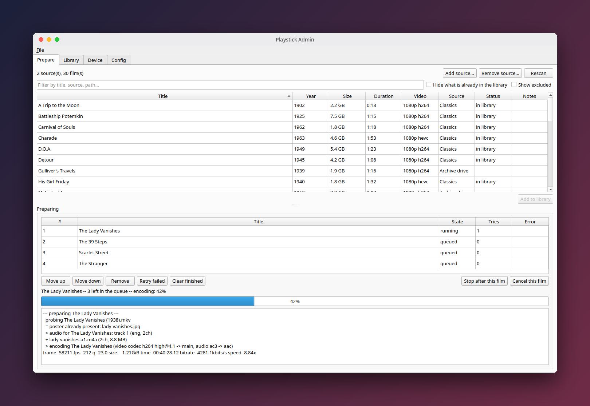
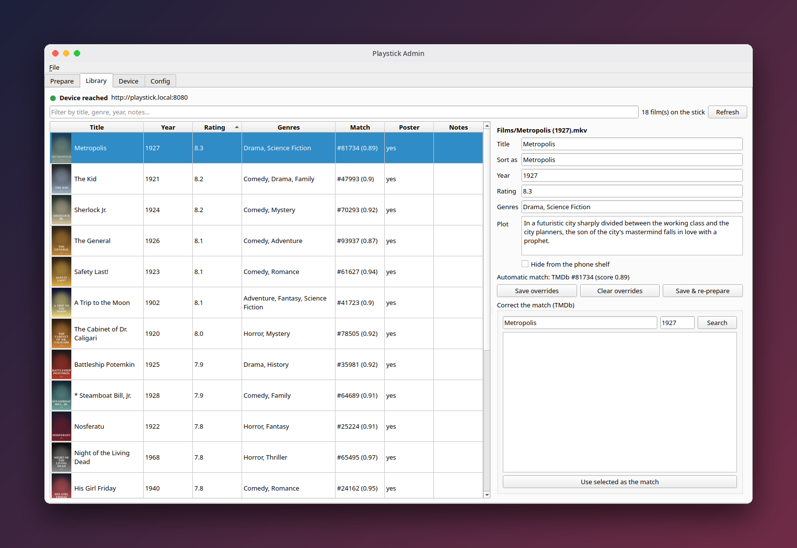
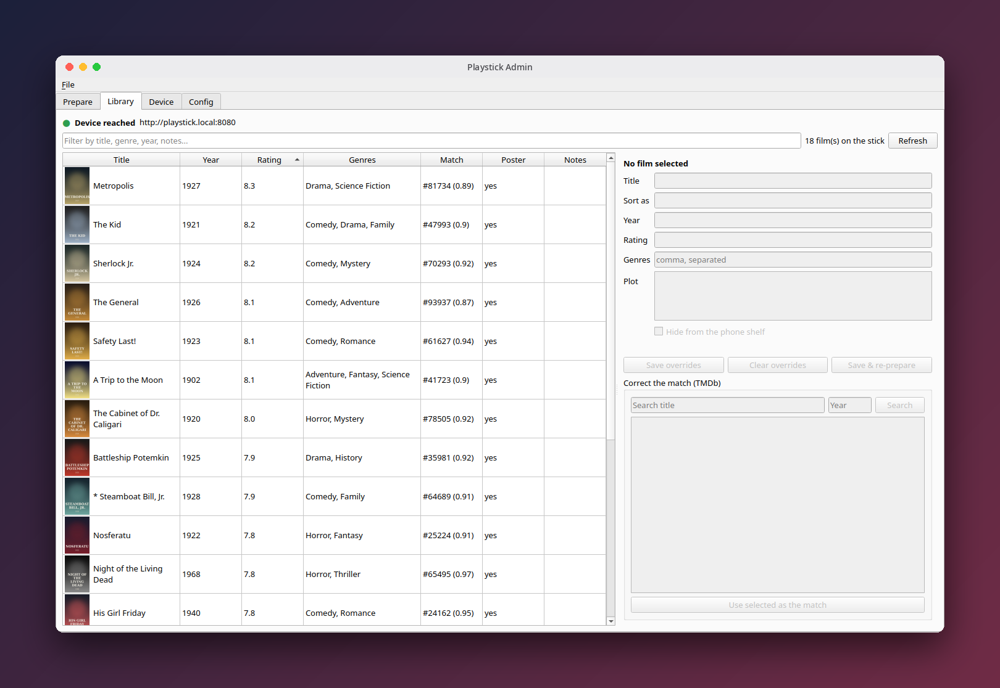
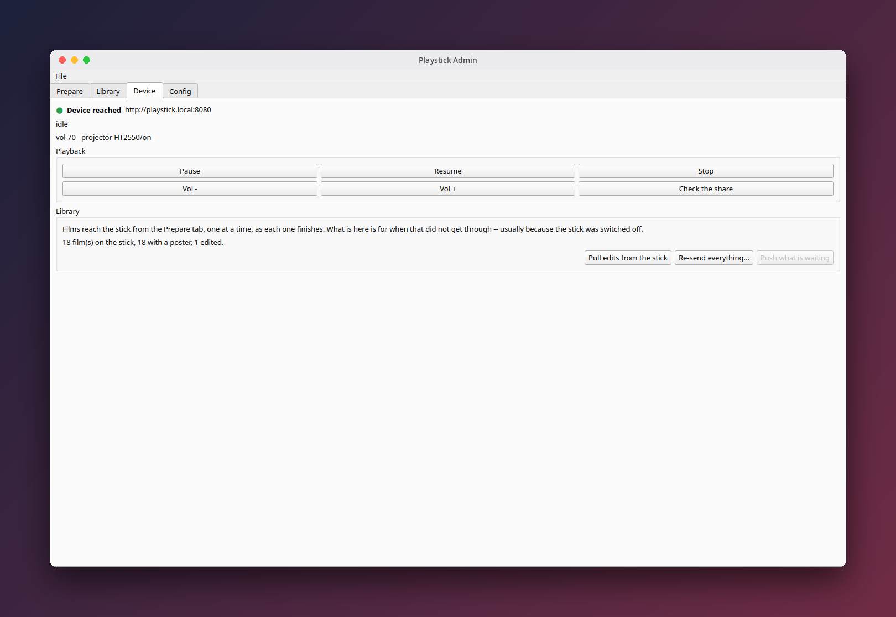
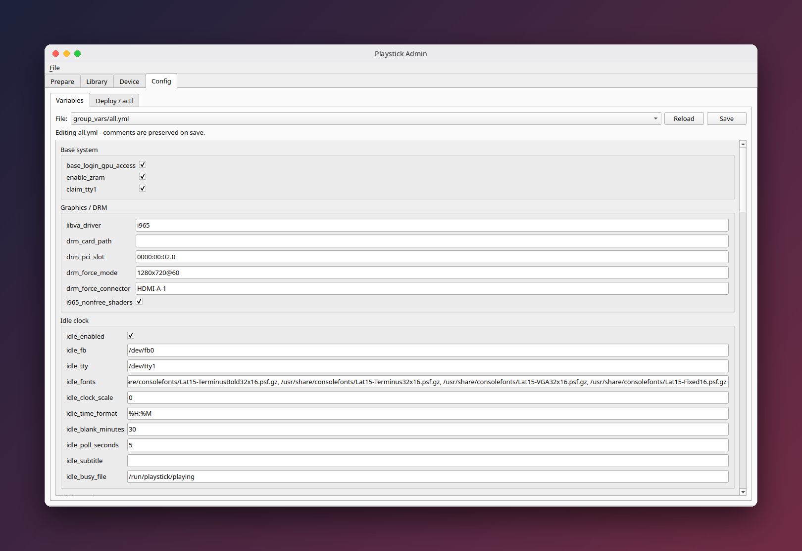

**Old tech meets modern software.**

Playstick turns an **ASUS VivoStick TS10** into a compact, dedicated media player 
that plugs directly into a projector's HDMI port.

It provisions and measures a minimal Ubuntu Server installation with video rendered 
directly through the Intel integrated graphics stack **without an X server or desktop environment**.

## What makes it different

* **No desktop, no X server.** Video goes straight to the Intel GPU over KMS/DRM via `cage`/`seatd` on `tty1`.
* **Fully provisioned by Ansible over SSH.** The device holds no state you can't rebuild; every tunable lives in `group_vars`, and the control node ships as a Docker image.
* **AirPlay mirroring receiver** built on [`UxPlay`](https://github.com/simukka/UxPlay) mirror any Apple device straight to the projector.
* **Child-friendly web movie library.** Plays films off a read-only CIFS NAS automount from a browser UI simple enough for a kid.
* **It controls the projector itself.** RS-232 switches the projector on and off, and an idle framebuffer clock shows when nothing is playing.

## Everyone can hear their own language

Every viewer opens the library on **their own device**, picks a language, and listens on their own headphones.
Each device pins its audio to the film's master clock, so the whole room stays in sync (a skip re-syncs everyone automatically). 
Two people watching the same film can hear it in different languages at once.

Great for multi-language households, friends, and parties.

## A desktop app to run the library

The heavy lifting happens on your own computer, not the stick. The **Playstick Admin** app (PySide6, `make admin`) 
scans your folders of films, lets you choose what goes on the stick, and prepares each film in the background: 
probing, re-encoding where the stick needs it, extracting per-language audio, and matching it on TMDb.

* **Prepare.** Every film on every source, in one sortable table. Select what you want and add it to the library; 
  the queue works through them one at a time and survives the app being closed.
* **Library.** What the stick is actually holding, with posters. Fix a title, genre or rating, or correct a bad TMDb match, 
  and the change goes straight to the stick.
* **Device.** Whether the stick is reachable, playback and volume controls, and recovery for films that didn't get through.
* **Config.** Edit the Ansible variables in `group_vars` with a form, and comments in the YAML are preserved.

More screenshots

*The screenshots use a demo library of public-domain films.*
